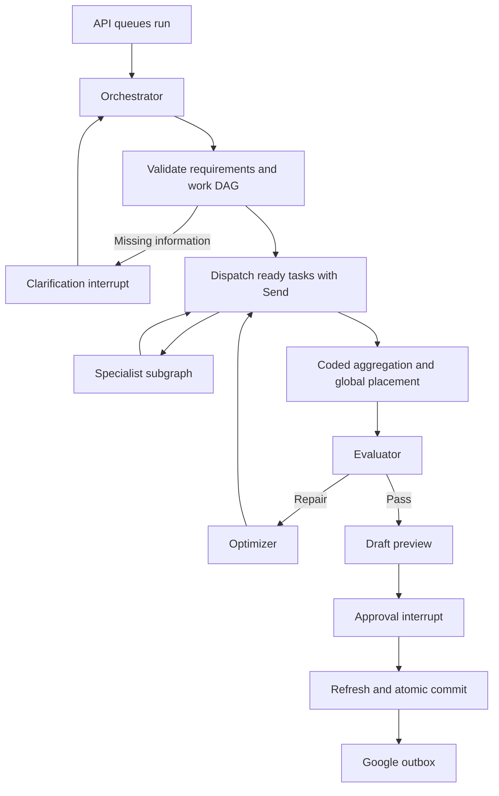

# Architecture and agent contracts

## Boundaries

The API authenticates requests and records durable jobs. A separate worker process executes LangGraph. Specialist workers are graph tasks, not separate hosted services. Independent tasks can execute concurrently, with a process-wide limit of two model requests.

Calendar authority lives in PostgreSQL application tables. Models cannot write calendar records or approve their own proposals.

Availability requests use coded interval arithmetic. Simple single-event proposals use typed extraction and coded validation; plans, researched answers, and multi-action proposals also receive semantic evaluation.

## Role contracts

All prompts are versioned in `app/agents/prompts.py`; Pydantic contracts are in `app/domain/contracts.py`.

| Role | Inputs | Outputs | Restrictions |
|---|---|---|---|
| Orchestrator | Latest request, recent messages, scoped facts, accepted preferences, fresh calendar and presets | Intent, canonical constraints, missing fields, work-order DAG, memory suggestions | Cannot invent missing availability, AM/PM, duration, or identities |
| Planning worker | Assigned objective/budget, constraints, relevant preferences, dependency outputs | Tasks, duration, order, optional allowed dates | Does not choose calendar clock times or exceed its assigned minutes |
| Action worker | Request, owned calendar records/revisions and presets | Typed create/update/delete/preset proposals | Imported external events are read-only; weekly edits are whole-series |
| Research worker | Assigned research objective | Bounded retrieved evidence and sourced synthesis | Public HTTPS only; no calendar mutations or preference writes |
| Conversation worker | Assigned question and verified relevant context | Answer | Cannot claim pending changes have been saved |
| Evaluator | Exact candidate revision, canonical request, evidence, coded result | Pass/revise/clarify/blocked, concrete issues and affected work orders | Cannot override coded validation or human approval |
| Optimizer | Issues, current work orders, canonical constraints | Replacement work orders or a user question | Preserves assigned identities and validated budgets; cannot change user constraints |

Clarification is a durable question node. Review is a deterministic preview builder. Scheduling and conflict detection are coded services.

## Data and execution

Each run has a server-generated checkpoint thread ID and belongs to an owned conversation. Using run IDs for checkpoint threads isolates failed/cancelled executions; conversation history and scoped facts connect successive runs.

Work results are keyed by task ID and version. The reducer accepts identical repeated deliveries, rejects conflicting duplicates, and ignores older versions when assembling a candidate. Repairs invalidate affected workers and their dependent tasks. Unaffected outputs are reused.

The optimizer stops after two rounds, a repeated candidate, a repeated issue set, sixteen model attempts, or five minutes of active execution. Interrupt waits do not consume worker time. An unresolved blocking issue never becomes an approvable draft.

Model responses, worker results, candidates, evaluation reports, and repairs have durable artifact records. Requested/actual model, usage, and prompt versions are recorded without API keys.

## Calendar correctness

- Interval calculations merge overlapping busy periods and subtract them from availability.
- OR-Tools places all generated tasks in one solve and enforces duration, deadlines, ordering, availability, and exact requested day count.
- Drafts are separate records and do not block free-time calculations.
- Each calendar mutation acquires the user's calendar row lock.
- Confirmation rechecks current data and validates the exact draft revision.
- Operation outcomes and Google outbox entries commit with the calendar transaction.
- Replaying after a domain commit returns its saved outcome instead of duplicating changes.
- Fenced checkpoint writes reject workers whose lease was lost.
- Fixed timestamps use UTC storage; weekly patterns retain local weekday/time and timezone.

Generated task durations must equal requested study time. An explicitly selected slack factor occupies additional calendar time and is shown in event labels. Start-after preferences limit placement.

## Research and models

OpenRouter model IDs remain configurable, but only explicitly free entries with structured-output support are allowed. Pricing is checked against the catalog; paid fallback and plugins are not enabled. Manual scheduling remains usable without OpenRouter.

Web retrieval validates and pins public IP addresses, checks redirects, requires HTTPS, and caps time and content. Retrieved text is evidence, never an instruction source.

## Evaluation

Run `python -m app.evaluations` for deterministic placement checks. With credentials and a development database, `python -m app.evaluations --live` creates a synthetic benchmark conversation and records evaluator judgments against labeled cases. It performs no approved calendar writes.

Live evaluator agreement supplements coded checks; a model judgment is not a proof of correctness.
