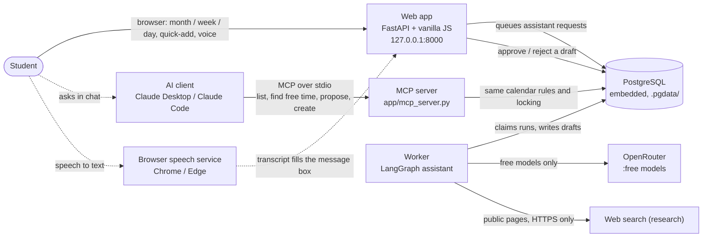

# Prototype architecture (demo)

Everything runs on one laptop and costs nothing: an embedded PostgreSQL, the web app, a background
worker for the AI assistant, and an MCP server that lets other AI tools use the same calendar.



## How a request flows

1. **Typed or spoken request** -> text lands in the message box (voice never auto-sends).
2. **Assistant** (worker + free model) works out a plan; code, not the model, checks times, overlaps
   and the total hours. Anything unclear becomes a question.
3. **Draft preview** shows exactly what will be added, changed or removed. Nothing is saved yet.
4. **Approve** commits it in one database transaction (idempotent, re-checked against the latest
   calendar). **Reject** discards it.

## The MCP server

| Tool | Writes? | What it does |
|---|---|---|
| `list_events(start_date, end_date)` | no | Events per day (weekly ones expanded), including unapproved proposals |
| `find_free_time(hours, from_datetime?)` | no | Earliest free slots adding up to the requested hours |
| `propose_event(title, date, start, end, color?)` | no | Checks an event against the calendar; explains conflicts and suggests free slots |
| `create_event(title, date, start, end, color?)` | **yes** | Saves the event (rejects overlaps and invalid times) |

It acts as one account (`MCP_USER_EMAIL` in `.env`) and is for local use only. The AI client's own
"allow this tool?" prompt is the approval step for `create_event`.

Connect it to Claude Code:

```bash
claude mcp add predestination -- <repo>/.venv/Scripts/python.exe <repo>/scripts/dev.py mcp
```

Claude Desktop (`claude_desktop_config.json`):

```json
{
  "mcpServers": {
    "predestination": {
      "command": "C:/path/to/scheduler/.venv/Scripts/python.exe",
      "args": ["C:/path/to/scheduler/scripts/dev.py", "mcp"]
    }
  }
}
```

## Not in the prototype (planned)

Google Calendar sync, accounts with password reset, paid or no-training models, proposals from MCP
appearing in the web approval queue, rate limits and quotas, deployment to Render, Neon and Netlify.
See the production plan for the full list.
